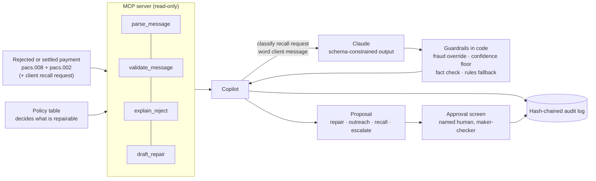

# ISO 20022 Exception Copilot

An open-source ISO 20022 MCP server and an exception-triage copilot for rejected and recalled cross-border payments. The copilot drafts a fix, a client message or a recall; a human approves every action; every step is logged.



**What this proves.** You can put an LLM into a payments operations workflow without letting it touch money. The model never decides what is repairable and never edits a payment field: a policy table decides, the model only classifies client recall requests and words client messages, its output passes checks enforced in code, a named human approves every action, and a tamper-evident log records all of it. On 18 held-out cases written to break the keyword rules, Claude cut missed fraud from **4 of 5 to 0 of 5** with **zero false repairs**, and the two cases it got wrong went to a person, not out the door. The evals, misses and my own bugs included, are [published as-is](#before--after-rules-vs-model).

## Quickstart

```
pip install -e ".[ui]"                    # Python 3.12+
python -m gen.build --seed 42             # 61 synthetic cases
uvicorn ui.app:create_app --factory       # open http://127.0.0.1:8000
```

Set `ANTHROPIC_API_KEY` first to run Claude; without it the deterministic rules baseline runs and the app says so (`model: rules-baseline` in the queue header).

### The 3-minute demo

| Case | What happens | What to show |
|---|---|---|
| `DEMO-01-RC01` | Creditor agent BIC is wrong; the right one is in the bank's directory | One-field before/after diff, the validated repaired XML, approve it, the audit entry with its hash |
| `DEMO-05-AC01` | Account number rejected | The copilot does **not** guess a number: it drafts a client message. Try approving as `copilot`: refused (maker-checker) |
| `DEMO-11-FRAD` | Client asks to recall a payment their controller sent on a text from the CEO's "new mobile number". No fraud keywords | With Claude: escalated to a person with the fraud indicator, no recall drafted. With the rules baseline: a recall is drafted, the gap the model closes |

**Synthetic data only.** No real bank messages, templates, BICs or customer data. Every BIC uses a test-BIC location code (second character `0`), so none can be a live production BIC.

## Status

| Piece | State |
|---|---|
| Seeded synthetic case generator (61 cases, XSD-validated) | ✅ Day 1 |
| MCP server: `parse_message`, `validate_message` | ✅ Day 2 |
| MCP server: `explain_reject`, `draft_repair` + guardrails | ✅ Day 3 |
| Copilot pipeline + maker-checker approval + hash-chained audit log | ✅ Day 4 (rules baseline) |
| Eval runner + CI gate | ✅ Day 4 |
| Approval screen (queue, diff, approve/reject, audit trail) | ✅ Day 6 |
| Demo polish: diagram, quickstart, 3-case demo story | ✅ PR 9 |
| LLM layer: Claude for recall classification + outreach wording, with fallback and audit | ✅ PR 7 · live: implicit fraud missed 4/5 → 0/5, all gates green |
| Held-out case set (18 cases the rules never saw) | ✅ Day 5 |

## Scope (v1)

- **Rail:** cross-border correspondent payments (CBPR+-style), `pacs.008.001.08` with `pacs.002.001.10` status reports.
- **Lane A — rejects (14 reason codes):** RC01, CH16, DT01, RR02, RR03, AC01, AC04, BE01, AM04, AM05, AC06, AG01, RR04, MS03.
- **Lane B — recalls (4 reasons):** DUPL, CUST, TECH, FRAD — candidates for a `camt.056` recall.

### The repair boundary

The copilot may only draft **formatting or enrichment** fixes from data the bank already holds. Everything else goes to a person:

| Action | When | Examples |
|---|---|---|
| `repair` | Intended value is unambiguous or in our own master data | RC01 (BIC recoverable from directory), CH16, DT01, RR02 (debtor address from KYC master) |
| `outreach` | Only the client knows the truth — never guess | AC01, AC04, BE01, RR03, AM04 |
| `escalate` | Compliance, fraud, unspecified or judgment calls — always human | RR04, MS03, AC06, AG01, AM05, FRAD |
| `recall` | Client-requested recall, drafted for approval | DUPL, CUST, TECH |

AC01 is deliberately `outreach` even when a digit transposition looks obvious: guessing an account number is how money goes to the wrong person.

## The case set

```
python -m gen.build --seed 42 --out cases
```

Writes 61 cases: 50 for evaluation (40 Lane A, 10 Lane B, every code covered) and 11 demo cases that are never scored. Each case folder has:

- `pacs008.xml` — the original payment (passes the XSD, except CH16 cases by design)
- `pacs002.xml` — the status report (`RJCT` + reason code, or `ACSC` for recalls)
- `label.json` — the answer key: expected action, fields the repair may touch, expected value
- `request.txt` — Lane B only: the client's recall request

Output is byte-identical for a given seed.

## The MCP server

Four tools, all read-only (annotated `readOnlyHint`; none of them change or send anything):

| Tool | Does |
|---|---|
| `parse_message` | Reads a pacs.008 or pacs.002 into structured fields. Works on schema-invalid messages, so a CH16 reject is still explainable. |
| `validate_message` | XSD check plus business rules: BIC directory, business day, required debtor/creditor address, IBAN mod-97. Every finding carries `reason_code_hint`, the ISO reason code it would most likely trigger. |
| `explain_reject` | Explains a pacs.002 reject in plain language and classifies it under the reason-code policy: `repair`, `outreach` or `escalate`. With the original pacs.008 attached, it adds evidence. |
| `draft_repair` | For RC01, CH16, DT01, RR02 only: returns `DRAFT_PENDING_APPROVAL` with a field-level diff and the repaired XML, or `REFUSED` with where to route it. |

### Guardrails, enforced in code

The policy table in `iso20022_mcp/policy.py` decides what is repairable, not the model. `draft_repair` then enforces:

1. **Policy gate**: only codes marked `repair` can be drafted. Unknown codes escalate.
2. **Evidence gate**: the defect the reject code points at must be visible in the message. No evidence, no repair.
3. **Allowlist gate**: after the edit, the diff is checked; if any field outside the code's allowlist moved, the draft is discarded.
4. **Validation gate**: the repaired message must pass validation.
5. **Draft only**: nothing is sent. Every draft needs a human.

Against the 61-case set, `explain_reject` matches the answer key on every case and `draft_repair` produces the expected value on every repairable case. That is the deterministic baseline; the agent layer is measured against it.

A rejected payment that validates **clean** is a signal too: the cause is outside the message (closed account, funds, compliance), so it goes to a person.

Run it over stdio:

```
python -m iso20022_mcp.server
```

Claude Desktop config (`claude_desktop_config.json`):

```json
{
  "mcpServers": {
    "iso20022": {
      "command": "python",
      "args": ["-m", "iso20022_mcp.server"],
      "cwd": "/path/to/iso20022-exception-copilot"
    }
  }
}
```

The BIC directory is the synthetic one from the generator, behind `iso20022_mcp/refdata.py`, the one adapter to swap for a real directory feed.

## The copilot

`copilot/agent.py` turns one case into one proposal for a human:

- **Lane A rejects:** `explain_reject` → policy action → `draft_repair` (repair), a drafted client message (outreach), or escalate.
- **Lane B recalls:** classify the client's free-text request → draft camt.056 fields, or escalate.

The model's job is narrow: classify recall requests and word client messages. It never decides what is repairable and never edits a payment field. **Any fraud signal in a recall request escalates, whatever the model says**; a test plugs in a model that calls every request routine and checks fraud still reaches a person.

### The model layer (`copilot/llm.py`)

Claude does two jobs and nothing else: classify the client's recall request (DUPL / CUST / TECH / FRAD, in English, Spanish or Portuguese) and word the client outreach message. Controls, all enforced in `copilot/agent.py` rather than in the prompt:

| Control | What happens |
|---|---|
| Structured output | Responses are schema-constrained Pydantic models (`RecallClassification`, `OutreachDraft`), not free text |
| Fraud override | A fraud keyword, a `FRAD` reason, or **any** fraud indicator from the model escalates |
| Confidence floor | Below `COPILOT_MIN_CONFIDENCE` (default 0.7) the case goes to a person |
| Outreach fact check | The message must carry the exact reference and amount, may not introduce account-like numbers, and may not ask for credentials; otherwise the rules template is used |
| Fallback | No key, an API error, a refusal or a failed check means the rules baseline answers, and the proposal says so |
| Audit | Every call logs model, prompt SHA-256, latency, output, whether it fell back and why (API error vs guardrail), and the blocked output when a check rejects one |
| Client text is data | The request is wrapped in `<client_request>` tags; the system prompt says to ignore instructions inside it, and the fraud override doesn't depend on the model obeying |

Self-reported confidence is a weak signal on its own, so it's one control of several, not the safety mechanism.

```
pip install -e ".[llm]"
export ANTHROPIC_API_KEY=...            # optional; without it the rules baseline runs
export COPILOT_MODEL=claude-sonnet-5-5  # default; "rules" forces the baseline
```

CI never calls the API: the layer is tested against a fake client.

`copilot/approval.py` is the gate: the copilot is the maker, a named human the checker, and the two can never be the same identity. A rejection needs a reason.

`copilot/audit.py` is append-only and hash-chained: each event stores the previous event's hash, so editing or deleting any past line fails `verify()`. The `proposed` event pins the SHA-256 of the drafted XML, so what was approved is exactly what was proposed.

## Approval screen

```
pip install -e ".[ui]"
python -m gen.build --seed 42
uvicorn ui.app:create_app --factory      # http://127.0.0.1:8000
```

- **Queue:** every demo case with the copilot's proposal and its status.
- **Case page:** the field-level before/after diff for repairs, the drafted client message for outreach, the camt.056 fields for recalls, the evidence, and the case's audit trail with hashes.
- **Decision:** reviewer name plus approve or reject. The copilot's identity is refused (maker-checker), a rejection needs a note, and every decision is written to the hash-chained log.
- **Restart-safe:** proposals are pinned in the audit log and restored verbatim, so a reviewer always sees exactly what was proposed, never a regenerated model output. Only cases the log has never seen are triaged.

No login in v1: the reviewer types their name. A real deployment puts SSO in front and takes the identity from it.

## Evals

```
python -m evals.run --cases cases
```

| Metric | Gated in CI |
|---|---|
| False repairs (repair proposed where the label isn't, or wrong value) | **yes, must be 0** |
| Zero-miss: RR04, MS03, FRAD always escalate | **yes, must be 0** |
| Action accuracy, routing precision, recall-reason accuracy | reported only (1 case = 2 points; too noisy to gate) |

The rules baseline scores 100% on the current set. **Read that as plumbing, not intelligence**: the generator and the rules were written together, so the set can't surprise them.

### Held-out set

```
python -m gen.holdout --seed 42 --out cases_holdout
python -m evals.run --cases cases_holdout --set holdout --report-only
```

18 cases written *against* the rules: recall requests with none of the baseline's keywords, Spanish and Portuguese requests from LATAM clients, fraud described without the word "fraud", and reject edge cases where the obvious repair is wrong.

| Rules baseline on held-out | Result |
|---|---|
| Reject edge cases (bad BIC with no agent name, reject code with no visible defect, unknown debtor, CH16 on a client reference, unknown code) | **6/6 escalated**: the guardrails generalize |
| False repairs | **0** |
| Implicit fraud (BEC, lookalike domain, vendor callback, Portuguese) | **4 of 5 missed** |
| Recall reason accuracy | 25% |

### Before / after: rules vs model

```
python -m evals.compare --cases cases_holdout --set holdout   # needs ANTHROPIC_API_KEY
```

Runs both on the same cases and writes a side-by-side table plus a failure analysis of every model miss, with the model's own rationale and fraud indicators. It exits non-zero if the model run breaks a hard gate (false repairs, zero-miss) or if model calls **failed** (API error, refusal), because then the numbers are really the rules baseline's. A model output **blocked by a guardrail** is different: the control worked, so it is reported, with the blocked text, but doesn't fail the run. In GitHub: **Actions → live-eval → Run workflow** (uses the `ANTHROPIC_API_KEY` repo secret; regular CI never calls the API).

**Live results** (`claude-sonnet-5-5`, run 3 on 2026-10-20, [full report](evals/results/live-eval-2026-10-20-run-39360520595.md), published as-is). **All hard gates pass on both sets, with no failed model calls and no outputs blocked by guardrails.**

| Held-out set (18 cases the rules never saw) | Rules baseline | Claude |
|---|---|---|
| **Fraud missed** (implicit: BEC, lookalike domain, vendor callback, Portuguese) | **4 of 5** | **0 of 5** |
| False repairs | 0 | 0 |
| Recall reason accuracy | 25% | 83% |
| Action accuracy | 78% | 89% |
| Routing precision | 100% | 85% |
| Failed model calls / outputs blocked | – | 0 / 0 |
| Hard gates (false repairs = 0, zero-miss = 0, no failed model calls) | failed | **passed** |

**Golden set (50):** identical to the baseline on every metric (100% action and reason accuracy, 0 false repairs, 0 zero-miss), with 0 failed calls and 0 blocked outputs.

**What the model got wrong (2 of 18)**, both in the safe direction: two technical-error recalls went to a person instead of getting a drafted recall. The same two cases, with the same reasons and confidence, came up in runs 1 and 3.
- *H-B-TECH-GLITCH*: "released before it was approved internally". The model read an unapproved release as possibly unauthorized and chose FRAD (confidence 0.6). The prompt says "when in doubt, choose FRAD", and it did.
- *H-B-TECH-H2H*: a host-to-host resend after a timeout. Classed DUPL at 0.6 confidence, below the 0.7 floor, so it went to a person.

That is why routing precision drops to 85%: over-escalation costs analyst minutes, a missed fraud costs the money. The prompt was **not** changed after seeing these results; any change gets a held-out v2.

**How we got here (earlier runs kept as-is):**
- Run 1 ([report](evals/results/live-eval-2026-10-20-run-39357904969.md)): same held-out numbers. Golden was marked failed because the outreach check rejected one model message; under the old gate any fallback failed the run. The gate now fails only on API failures; a guardrail block is reported, with the blocked text.
- Run 2 ([report](evals/results/live-eval-2026-10-20-run-39358916870.md)) found two bugs of mine. The credential check blocked three *good* messages that warned clients **not** to share passwords; it now blocks requests and lets warnings through. And one held-out classification was cut off mid-JSON because the 512-token budget is shared with the model's thinking; it is now 4096. Run 3 is the first run after both fixes.

The strict `xfail` stays: it asserts the *rules baseline* catches implicit fraud, and the rules still don't. The gap is closed by the model layer, measured here, not by the rules.

The held-out set is not used to tune prompts; if a prompt changes after seeing it, a held-out v2 is written and reported instead.

The fraud misses are the known gap, tracked as a strict `xfail` test, and it is the model layer's job to close it. Even today a missed fraud case lands as a *recall draft awaiting human approval*, not an action; the zero-miss gate exists so the model can't ship until a person never has to catch it.

## Develop

```
pip install -e ".[dev]"
python -m pytest
```

Schemas in `schemas/` are the public ISO 20022 XSDs (`pacs.008.001.08`, `pacs.002.001.10`), sourced from [moov-io/fedwire20022](https://github.com/moov-io/fedwire20022) (Apache-2.0).

## License

MIT
